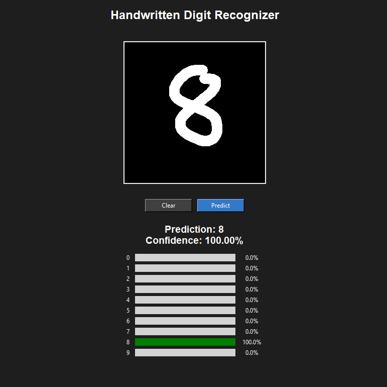

# MNIST Handwritten Digit Recognizer

A handwritten digit recognition application built with Python, PyTorch, and Tkinter. The application uses a Convolutional Neural Network (CNN) to classify user-drawn digits from 0 to 9 and displays prediction confidence scores for each digit.

## Demo



## Features

- Interactive drawing canvas for handwritten digits
- Real-time predictions when clicking the Predict button
- Confidence scores for all 10 digit classes
- Image preprocessing with Pillow, including cropping, resizing, and centering
- CPU-based inference using a pretrained CNN
- GPU-accelerated training when CUDA is available

## Model Architecture

The CNN was built using PyTorch and consists of:

1. Convolutional layer with 16 filters (3×3), followed by ReLU and max pooling
2. Convolutional layer with 32 filters (3×3), followed by ReLU and max pooling
3. Fully connected layer with 128 neurons and ReLU
4. Output layer with 10 scores corresponding to digits 0–9

The model was trained on the MNIST dataset, containing 60,000 training images and 10,000 test images.

## Model Performance

Three neural network architectures were tested during development:

| Model | MNIST Test Accuracy |
|---|---:|
| Fully Connected Neural Network | 97.49% |
| Simple CNN | 97.71% |
| Improved CNN | **98.97%** |

The improved CNN achieved the highest observed accuracy in these experiments.

**Note:** Test accuracy was measured on MNIST images. Performance on mouse-drawn digits may differ because of differences in handwriting and image preprocessing.

## Installation

**Requirements:** Python 3.13 and Git.

Clone the repository:

```bash
git clone https://github.com/kevhuang34/MNIST-Digit_Recognizer.git
cd MNIST-Digit_Recognizer
```

Create a virtual environment:

```bash
python -m venv .venv
```

Activate the virtual environment (Windows PowerShell):

```powershell
.\.venv\Scripts\Activate.ps1
```

Install dependencies:

```bash
python -m pip install -r requirements.txt
```

## Running the Application

Launch the application:

```bash
python app.py
```

Draw a digit and click **Predict** to see the model's prediction and confidence scores.

Click **Clear** to erase your drawing.

The repository includes `mnist_cnn.pth`, so training is not required to run the application.

## Training the Model

To train a new CNN using the MNIST dataset:

```bash
python main.py
```

The script downloads MNIST if needed, trains the model for five epochs, evaluates it on the test dataset, and saves the trained weights to `mnist_cnn.pth`.

Running the training script overwrites the existing model checkpoint.

## Technologies Used

- **Python** — Application and training code
- **PyTorch** — Neural network architecture, training, and inference
- **Torchvision** — MNIST dataset loading and image transformations
- **Tkinter** — Desktop graphical interface
- **Pillow** — Drawing storage and image preprocessing

## Future Improvements

- Improve recognition of mouse-drawn digits through data augmentation
- Evaluate the model on a separate collection of user drawings
- Add additional model architectures for comparison
- Create a browser-based version of the application